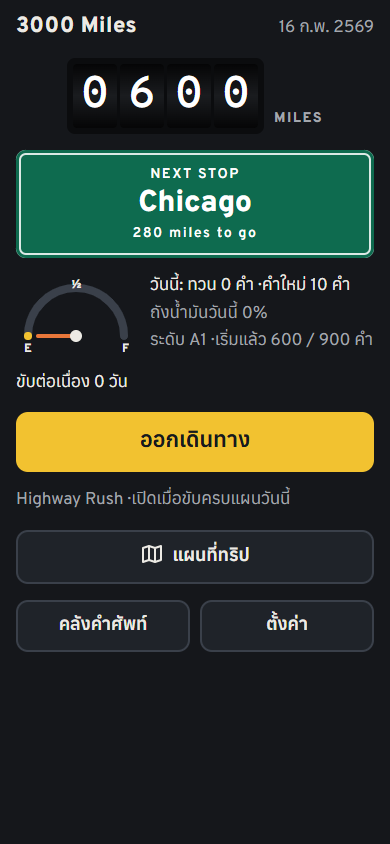
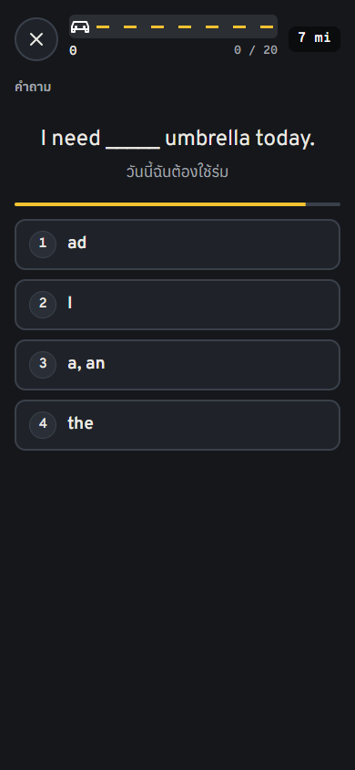
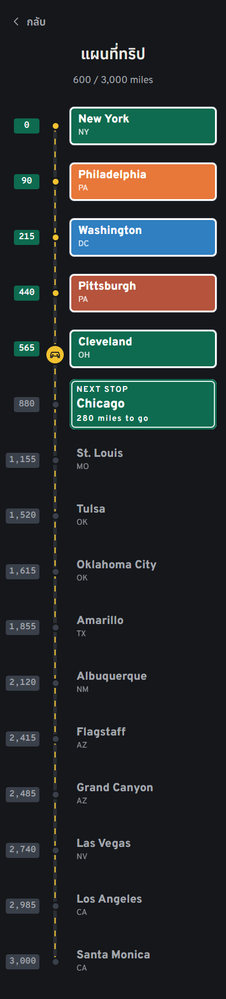

# 3000 Miles

A road-trip vocabulary game for Thai learners of English. Learn the 3,000 words of
The Oxford 3000 (American English) and drive across the USA: every word you really learn
is one mile, from New York to Santa Monica Pier.

<p>
  
  
  
</p>

It is a static web app (a PWA): it installs on a phone, works offline and keeps your
progress in the browser. The interface is in Thai, the words are American English.

## How it teaches

- **Test before teaching.** A new word is asked first. The lesson card only appears after a
  miss, because trying first makes the lesson stick. After that, every contact with a word
  is a question (retrieval practice).
- **Spaced repetition.** Leitner boxes with growing intervals. A word counts as a mile only
  after right answers on three different days; a forgotten word comes back as a "flat tire"
  to fix. The odometer never goes down.
- **Harder as you get better.** Questions start with meaning and listening, then move to
  look-alike word choices (band / bank / hand), gap-fill, typing, dictation and speaking.
  Hints get shorter as a word gets stronger.
- **Known words go fast.** A right first answer skips the lesson, and one typed answer
  proves you know it.
- **Stakes, not punishment.** Score, combos, stars, and a typed checkpoint exam at every
  city (80% to pass, once a day) make each answer count. A bad answer can cost points or a
  day's wait, never miles.
- **Limit new words, not play.** New words are capped per day, because every new word
  brings 5-8 reviews. Highway Rush, a 60-second arcade round that never touches your
  cards, has no limit.
- **One level at a time.** New words come in order: A1, A2, B1, then B2. The road gets
  harder as you drive west.
- Every word has a Thai meaning, an everyday American example sentence with a Thai
  translation, and text-to-speech.

The full rules are in [docs/DESIGN.md](docs/DESIGN.md).

## Run

Needs Node.js 22+. Run `npm start` (or double-click `start.bat`) and open
http://localhost:5320. The server also prints a LAN address for trying it on a phone.

```
npm test          # unit tests for the game logic and the tools
npm run check     # content status; `npm run check -- a1-02` validates one batch
npm run build:data
npm run ui        # headless Chrome check (needs Google Chrome), screenshots in .shots/
```

To put it online, upload the `public` folder to any static host
([docs/DEPLOY.md](docs/DEPLOY.md), in Thai).

## How it was built

- Plain ES modules, no framework, no build step, no npm dependencies. Fonts are
  self-hosted and the app makes no requests to other sites, so it works offline.
- The game logic (random numbers, days, spaced repetition, question making, daily plans,
  score, checkpoints) lives in pure modules that never touch the DOM, storage or the clock.
  Today's date and the random source are parameters, so every run can be repeated
  (`?test&seed=1&today=20500`).
- Node's built-in test runner covers the pure modules and the tools.
- `npm run ui` drives headless Chrome over the DevTools protocol: it plays whole legs,
  exams and Highway Rush runs, checks layouts at phone and laptop sizes in light and dark,
  checks the offline service worker, times a question on a 4x CPU slowdown, and fails on
  any JavaScript error.
- Content pipeline: the base list is built from the free Oxford PDFs
  (`tools/build-wordlist.mjs`); Thai meanings and examples are hand-written JSON batches
  of 100 words in `content/`, and `tools/check-content.mjs` validates them (Thai only in
  the meaning, one bracketed target word per example, warnings for words outside the list, and
  more). Flagged words from play are fixed with `tools/flags.mjs`.

## Credits

Word list: The Oxford 3000™ (American English) © Oxford University Press. This is a
personal learning project, not affiliated with or endorsed by Oxford University Press.
Thai meanings, example sentences and translations were written for this project.
Fonts: Overpass, Overpass Mono, Anuphan (SIL Open Font License).
